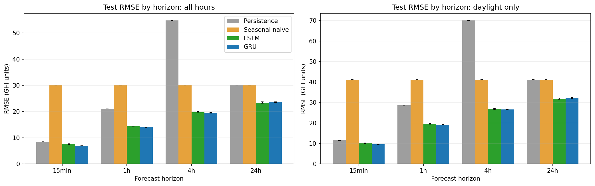
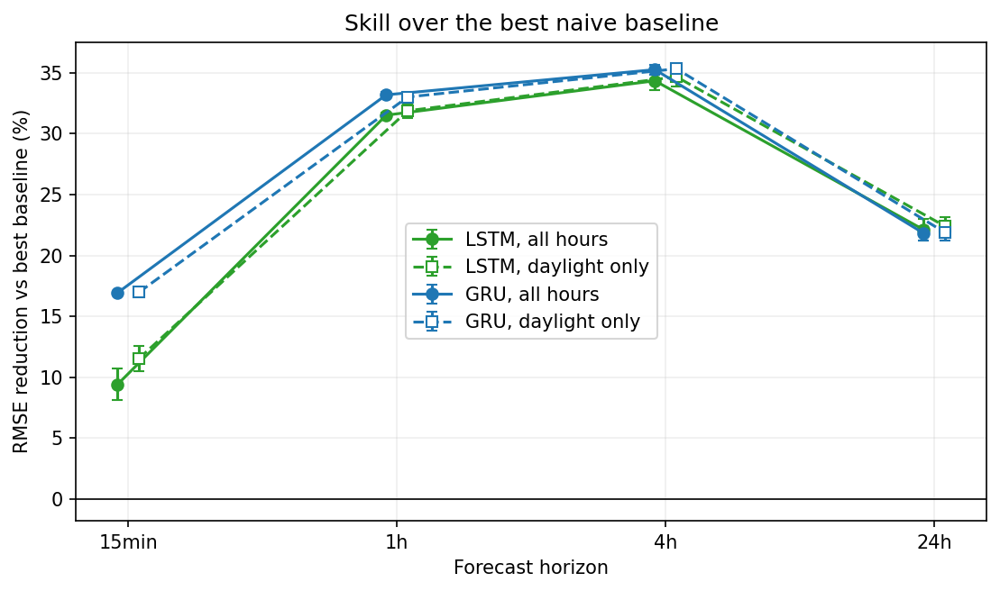
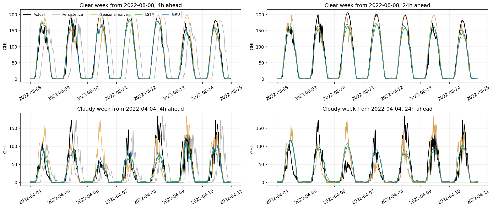
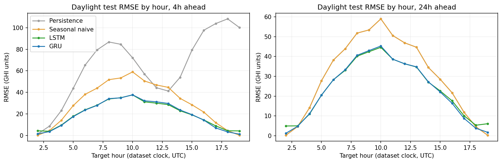
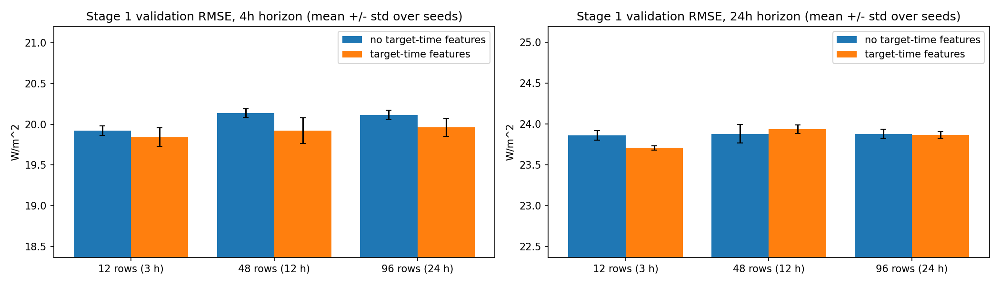

# Solar Irradiance Forecasting

Reproducible solar Global Horizontal Irradiance (GHI) forecasting with a leakage-safe preprocessing pipeline, simple time-series baselines, and compact PyTorch LSTM/GRU models.


## What This Project Shows

- Chronological time-series splitting for train/validation/test.
- Train-only fitted preprocessing for target transforms, low-radiation thresholds, feature scalers, and target scalers.
- Baseline comparison against persistence and seasonal naive forecasts.
- LSTM and GRU sequence models with checkpoint save/load support.
- A script-first workflow for reproducible training, evaluation, and comparison.
- Resumable, multi-seed Colab sweeps with validation-only model selection and daylight-only test metrics.
- A small Colab smoke notebook for verification without local training.

## Quick Start

```bash
python -m venv .venv
source .venv/bin/activate
pip install -e ".[dev,notebooks]"
pytest
solar-predict compare --data data/sample/SolarPrediction_sample.csv --epochs 1 --hidden-dim 8 --quiet
```

For a no-local-training check, open `notebooks/colab_smoke_check.ipynb` in Colab (which clones this GitHub repo directly, no Google Drive required). For the full dataset, the Colab notebooks download `solar_weather.csv` from a Hugging Face Dataset repo (`itxtx/solar-prediction-data` by default) and upload checkpoints, metrics, and plots to a Hugging Face Model repo (`itxtx/solar-prediction-artifacts` by default) using `HF_TOKEN`:

- `notebooks/colab_full_run_actual_data.ipynb`: single-horizon baseline and model comparison (older single-seed workflow).
- `notebooks/colab_horizon_sweep_actual_data.ipynb`: GRU and LSTM at 15-minute, 1-hour, 4-hour, and 24-hour horizons over 3 seeds with one shared configuration, scored on test against both baselines over all hours and daylight hours only. Saves test forecasts and the report plots below. Resumable like the tuning notebook.
- `notebooks/colab_gru_tuning_actual_data.ipynb`: resumable two-stage GRU sweep on 4-hour and 24-hour horizons over 3 seeds. Stage 1 varies the input window and `--target-time-features`; stage 2 varies hidden size, layers, and learning rate on the stage-1 winner. Winners are chosen by mean validation RMSE and frozen before a one-shot test evaluation against persistence and seasonal-naive baselines, over all hours and daylight hours only. Finished runs are uploaded as they complete and restored from the Hub on rerun.

The comparison command prints a CSV-style metrics table:

```text
model,rmse,mae,r2,capped_mape
persistence,...
seasonal_naive,...
lstm,...
gru,...
```

For a slightly longer neural run:

```bash
solar-predict train --model lstm --data data/sample/SolarPrediction_sample.csv --output artifacts/ --epochs 5
solar-predict evaluate --model lstm --checkpoint artifacts/lstm_model.pt --data data/sample/SolarPrediction_sample.csv
```

Generated checkpoints and metrics are written to `artifacts/`, which is intentionally ignored by Git.

`train` and `compare` also accept:

| Flag | Default | Meaning |
| --- | --- | --- |
| `--horizon-steps` | 1 | Forecast this many rows after the end of the input window |
| `--window-size` | config (12) | Input rows per sequence; 12 rows is 3 hours of 15-minute data |
| `--target-time-features` | off | Add calendar and sun-schedule features at the target time, plus the target observed whole days before it |
| `--num-layers` | 1 | Stacked recurrent layers |
| `--dropout` | 0.1 | Dropout before the output head (and between layers when there are 2 or more) |
| `--learning-rate` | 0.001 | Adam learning rate |
| `--patience` | 10 | Early stopping: stop after this many epochs without validation improvement; `--epochs` is the cap |

Each run's metadata records these hyperparameters and the git commit.

## Full-Data Results

Test-split results on `solar_weather.csv` (15-minute rows, 2017-01 to 2022-08, chronological 60/20/20 split) from `colab_horizon_sweep_actual_data.ipynb`. Every network uses the same configuration: a 12-row (3-hour) window, target-time features, hidden size 32, one layer, early stopping. Values are mean ± standard deviation over 3 seeds; RMSE is in the dataset's GHI units.

**Daylight hours only** (target time between sunrise and sunset):

| Horizon | Best baseline RMSE / R² | GRU RMSE / R² | LSTM RMSE / R² | GRU skill |
| --- | ---: | ---: | ---: | ---: |
| 15 min | 11.48 / 0.961 (persistence) | **9.53 ± 0.01** / 0.973 | 10.15 ± 0.12 / 0.970 | 17% |
| 1 h | 28.63 / 0.758 (persistence) | **19.18 ± 0.08** / 0.892 | 19.50 ± 0.16 / 0.888 | 33% |
| 4 h | 41.08 / 0.502 (seasonal naive) | **26.57 ± 0.17** / 0.792 | 26.84 ± 0.32 / 0.788 | 35% |
| 24 h | 41.08 / 0.502 (both equal) | 32.10 ± 0.25 / 0.696 | **31.88 ± 0.31** / 0.700 | 22% |

**All hours:**

| Horizon | Best baseline RMSE / R² | GRU RMSE / R² | LSTM RMSE / R² |
| --- | ---: | ---: | ---: |
| 15 min | 8.41 / 0.976 | **6.98 ± 0.00** / 0.983 | 7.61 ± 0.11 / 0.980 |
| 1 h | 21.03 / 0.847 | **14.05 ± 0.06** / 0.932 | 14.40 ± 0.05 / 0.928 |
| 4 h | 30.09 / 0.688 | **19.48 ± 0.12** / 0.869 | 19.76 ± 0.23 / 0.865 |
| 24 h | 30.09 / 0.688 | 23.53 ± 0.18 / 0.809 | **23.44 ± 0.27** / 0.811 |

Skill is the reduction in RMSE relative to the best naive baseline at that horizon.

### Key Takeaways

- **Both networks beat the best naive baseline at every horizon.** The gain is largest at 1–4 hours (about 33–35% lower daylight RMSE). It is smaller at 15 minutes, where persistence is already strong, and at 24 hours, where past observations say little about tomorrow's clouds.
- **GRU and LSTM are nearly tied.** The GRU is slightly better up to 4 hours, the LSTM slightly better at 24 hours, and the gaps are only a few seed standard deviations.
- **Night hours flatter the all-hours metrics.** About half the targets are night zeros, so all-hours R² is 0.08–0.11 higher than daylight R² at 4 and 24 hours. Daylight metrics are the honest comparison.
- **Configuration barely matters.** The two-stage GRU sweep (`colab_gru_tuning_actual_data.ipynb`, 4-hour and 24-hour horizons, 3 seeds) tried 3-, 12-, and 24-hour windows, target-time features on and off, hidden size 32/64, 1–2 layers, and two learning rates. All 26 configurations landed within about 2% of each other on validation RMSE (19.76–20.14 at 4 hours, 23.71–23.94 at 24 hours). Target-time features helped by 0.4–0.6% with the 12-row window; longer windows did not help.
- **The limit is information, not the model.** Past weather observations cannot see clouds hours ahead. Further gains need inputs about the future, such as numerical weather forecasts, or a better target, such as the clear-sky index.
- **Plain persistence is weak at 4 hours.** It copies the value from 4 hours earlier, which is out of phase with the daily cycle (all-hours R² −0.04). Skill is therefore measured against the best baseline at each horizon, which at 4 hours is seasonal naive.
- **The networks smooth peaks.** Trained on squared error, they predict close to the expected value, so they undershoot clear-day peaks and miss sharp cloudy-day spikes (see the example forecasts).

`capped_mape` is reported by the CLI, but solar irradiance has many near-zero/night values, so RMSE, MAE, and R² are the headline metrics.











### Known Limitations

- The dataset has 10 gaps of 1–5 days; forecast windows that cross a gap are treated as contiguous (under 1% of sequences).
- GHI peaks at 229, well below typical clear-sky irradiance of 800–1000 W/m², so the units are unverified. Treat RMSE as relative to this dataset's scale.
- Results cover a single site.

## Data

The repository tracks only a small sample dataset:

- `data/sample/SolarPrediction_sample.csv`

Expected columns for the tracked sample:

- `UNIXTime`
- `Data`
- `Time`
- `Radiation`
- `Temperature`
- `Pressure`
- `Humidity`
- `WindDirection(Degrees)`
- `Speed`
- `TimeSunRise`
- `TimeSunSet`

The pipeline also supports the weather-style schema used by the larger local dataset, including `GHI`, `temp`, `pressure`, `humidity`, `wind_speed`, `clouds_all`, `rain_1h`, and `snow_1h`.

Full datasets and trained model weights are not committed. Keep them local, place small reproducible samples under `data/sample/`, and regenerate model artifacts with the CLI.

## Methodology

The core pipeline lives in `solar_prediction.data_prep.prepare_weather_data`.

Important implementation details:

- Rows are sorted chronologically, preferring `UNIXTime` when present.
- Sequence split boundaries are computed before fitted preprocessing.
- Target transforms and scalers are fit only on training target rows.
- Feature scalers and low-radiation thresholds are fit only on training feature rows.
- Validation and test data are transformed with the training-fitted objects.
- CLI checkpoints bundle a `WeatherPreprocessor` with the model. Evaluation loads it without refitting, including feature order, transforms, scalers, window size and horizon.
- Features are forward filled; leading gaps use saved training medians. Missing target labels raise an error.

`evaluate` defaults to scoring the test split of a full dataset. For a separate held-out file, pass `--evaluation-scope all`; its first `window_size + horizon_steps - 1` rows provide context. The Python `preprocessor.sequences(data, history=prior_data)` interface can instead supply preceding observations explicitly. An explicit evaluation horizon must match the checkpoint.

Older checkpoints without a fitted preprocessor require retraining for CLI evaluation. Existing model-only loading and the nine-element `prepare_weather_data` return tuple remain available.

This avoids the common time-series leakage pattern where scalers or target transforms learn from future validation/test values.

## Models

The portfolio comparison includes:

- **Persistence baseline**: predicts the future value from the most recent observed value at the configured horizon.
- **Seasonal naive baseline**: predicts from the same time of day in a previous daily cycle when available.
- **LSTM**: compact recurrent neural network implemented in PyTorch.
- **GRU**: compact recurrent neural network implemented in PyTorch.

## Repository Layout

```text
solar_prediction/
  cli.py              # train/evaluate/compare command-line workflow
  config.py           # centralized (pydantic) configuration for pipeline and models
  preprocessing.py    # fitted preprocessor and named train/val/test sequence data
  data_prep.py         # preprocessing helpers and legacy tuple wrapper
  data_loader.py      # data loading utility (chunked CSV reading)
  lstm.py             # PyTorch LSTM model
  gru.py              # PyTorch GRU model
  checkpointing.py    # model checkpoint save/load
  benchmark.py        # timing/benchmark utilities for pipeline operations
  memory_tracker.py   # memory-usage tracking for PyTorch models
  plot_utils.py       # evaluation and plotting helpers
  sweep.py            # resumable multi-seed sweeps, test scoring, and forecast export
  report_plots.py     # report figures for sweep results
  hf_hub.py           # Hugging Face dataset download and artifact upload/restore
tests/                # unit and smoke tests
data/sample/          # tracked sample data
notebooks/            # Colab smoke check, horizon sweep, and GRU tuning sweep
plots/                # figures used in this README
```

## Development

```bash
pip install -e ".[dev,notebooks]"
ruff check solar_prediction tests
black --check solar_prediction tests
pytest --cov=solar_prediction --cov-report=term-missing
```

CI runs linting, tests, and a fast CLI smoke comparison on the tracked sample dataset.
